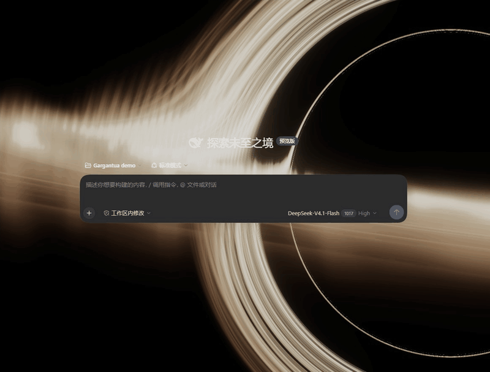

# Gargantua Black Hole for DSH · Interstellar-inspired background

A real-time 4K black hole behind **DeepSeek Harness** conversations, also known as **卡冈图雅黑洞 / 星际穿越动态背景**. Prominent in new conversations and dimmed during chat, without blocking the sidebar, typing, scrolling or selection. **0.2.1 · Verified on Desktop 0.2.1-rc.3.**

[Download plugin](https://github.com/2bigpig/dsh-gargantua/releases/download/v0.2.1/dsh-gargantua-0.2.1.tgz) · [Live animation](https://2bigpig.github.io/gargantua/) · [Engine source](https://github.com/2bigpig/gargantua) · [中文](README.md)



A compressed recording from an isolated rc.3 Desktop, using fictional messages. Actual drawing remains **3840×2160**.

## Ask AI to install

> Read https://raw.githubusercontent.com/2bigpig/dsh-gargantua/main/INSTALL_FOR_AI.md and install and enable the Gargantua black hole plugin for me; verify that it is active when finished.

On Desktop rc.3, select **Creator mode** so DSH can use its official `plugin_manager`. External assistants need desktop interaction capability to install into Desktop. Terminal-only assistants can target a Web profile. Follow any approval prompts required by DSH. See [INSTALL_FOR_AI.md](INSTALL_FOR_AI.md), which includes English instructions.

## Manual install / uninstall

Download `dsh-gargantua-0.2.1.tgz` from [Release v0.2.1](https://github.com/2bigpig/dsh-gargantua/releases/tag/v0.2.1); no Node.js or source build needed. Verify using the attached `SHA256SUMS.txt`.

**Desktop:** Plugins → Add plugin → paste the absolute package path or download URL → Install → Enable now. Select a workspace and open a new conversation. Disable or uninstall from plugin details. Remove an older version before reinstalling. Desktop profiles are application-owned and cannot be modified using CLI.

**Web:** with DSH CLI already installed:

```sh
dsh plugin --profile web add "https://github.com/2bigpig/dsh-gargantua/releases/download/v0.2.1/dsh-gargantua-0.2.1.tgz"
dsh plugin --profile web remove dsh-gargantua
```

Replace `web` if the active Web profile has another name. Follow the host's reload/restart result. A downloaded package alone is not an installed, active plugin.

## Automatic dark appearance

Each time the plugin activates or DSH starts, it waits for the Host theme settings, then uses the official theme service to **switch the entire DSH interface to dark and save that preference**. It runs once per initialization; sending messages and switching conversations do not trigger another switch. You can subsequently choose Light or System in Settings → General. Disabling or uninstalling keeps your current appearance. The next activation or start selects Dark again.

This prevents the black hole from disappearing against light chat surfaces. Read-only settings, loading or persistence failures produce console diagnostics without repeated enforcement. Select Settings → General → Dark manually if needed.

Existing users must upgrade to v0.2.1; repository updates do not automatically replace installed plugins.

## Behavior / compatibility

- No added animation text, settings UI or pause controls. DSH's own interface remains available.
- Fixed actual **3840×2160**; container-aspect-corrected rays, continuous autoplay, 60fps scheduling ceiling. Actual performance depends on the GPU.
- Dark new/chat opacity **85% / 12%**; light **30% / 8%**.
- Legacy pause/quality settings are ignored. Reduced motion and visibility do not deliberately pause drawing. Freezing, background scheduling or graphics failure can interrupt it; failure displays a text-free still.
- Desktop **0.2.1-rc.3** install/uninstall, both themes, history changes, resizing, typing and selection were verified. Other host versions require compatibility checks.
- No model calls, sent messages or CDN. Component teardown/uninstall disposes graphics resources.

If absent, check activation, selected workspace, open conversation, hardware acceleration and plugin errors. The host layout must provide `data-conversation-scroll`; unsupported layouts do not attach a full-window background.

## Build / maintain

Node.js 22+:

```sh
git clone https://github.com/2bigpig/dsh-gargantua.git
cd dsh-gargantua
npm ci
npm run build
npm pack
```

Outputs `lib/client.js` and `dsh-gargantua-0.2.1.tgz`. Builds use the fixed in-repo engine snapshot; no adjacent checkout is needed. Explicitly synchronize from the maintenance source with:

```sh
npm run sync:engine -- "<gargantua-source-directory>"
npm run build
```

Sync records version and SHA-256. React is host-supplied; rendering dependencies and fallback images are embedded. Integration uses DSH's module loader, Cordis bundle and `conversation.input.dock`.

## Credits

MIT © 2026 **2bigpig**. Engine from [gargantua](https://github.com/2bigpig/gargantua), based on [dgreenheck/webgpu-black-hole](https://github.com/dgreenheck/webgpu-black-hole) (MIT), using Three.js. [dsh-ascii-ocean](https://github.com/GqqQq-Q/dsh-ascii-ocean) was an integration reference; no ocean implementation was copied. See [THIRD_PARTY_NOTICES.md](THIRD_PARTY_NOTICES.md) and [LICENSE](LICENSE).

An artistic approximation inspired by *Interstellar*. No film footage, stills or personal-site content.
